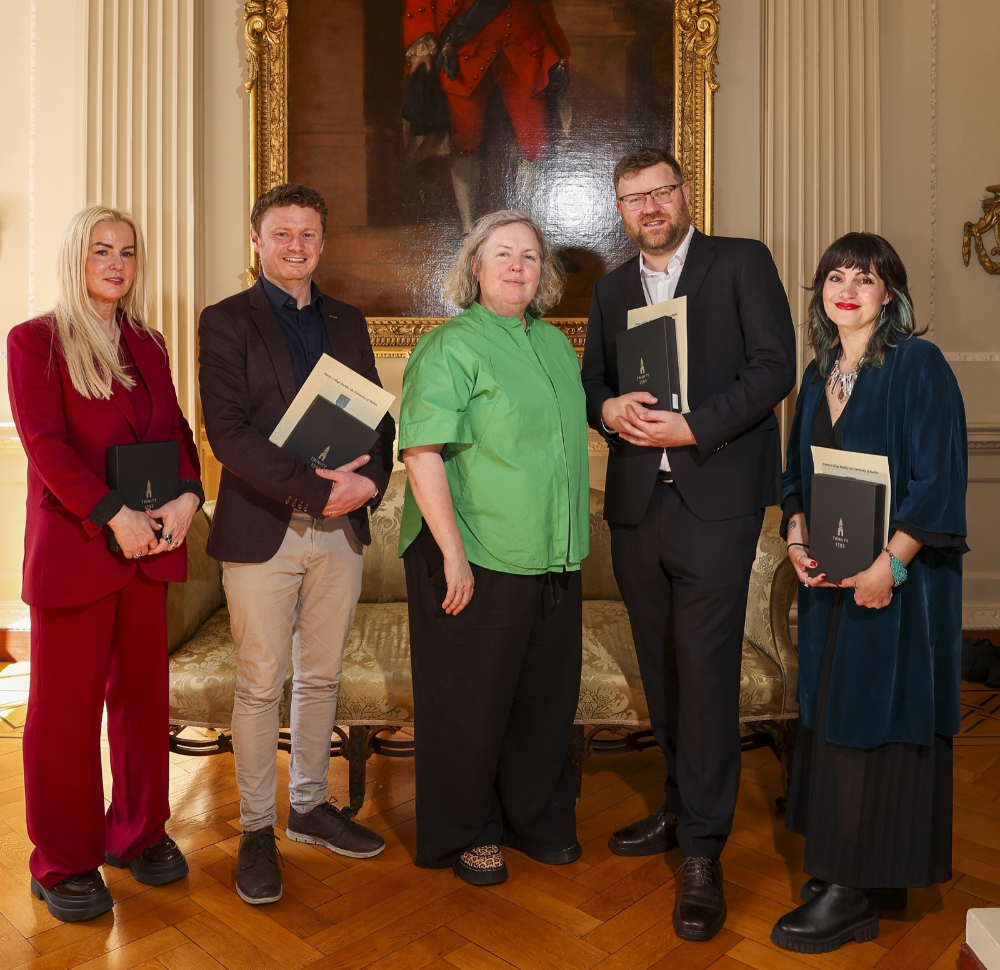

We are thrilled to share that **Prof. François Pitié** was recognised with a
rare double honour at the **2026 Trinity Teaching Awards**, receiving both the
**University Excellence in Teaching Award** and the **Inspiring Educator Award**
from Provost Linda Doyle on June 12.

The awards recognise his work bringing research-led AI teaching into the
Engineering curriculum since launching Ireland’s first undergraduate Deep
Learning module (**4C16/5C16**), complete with a bespoke cloud lab environment
and custom autograder built so students can safely experiment, break things, and
learn by doing.

While the trophies carry one name, anyone involved in 4C16/5C16 knows it is a
major team endeavour. A huge thank-you goes to **Vibhoothi** for expertly
crafting and maintaining the lab platform, and to all the **PhD students and
postdocs across the Sigmedia group** who have tutored, tested assignments, and
supported hundreds of students over the years—without them, 4C16/5C16 simply
wouldn't exist.

### Relevant Links
* [TCD School of Engineering News Announcement](https://www.tcd.ie/engineering/news/2026/professor-franois-pitie-recognised-with-dual-honours-at-2026-trinity-teaching-awards/)
* [4C16/5C16 Deep Learning Course Website](https://frcs.github.io/4c16/)

