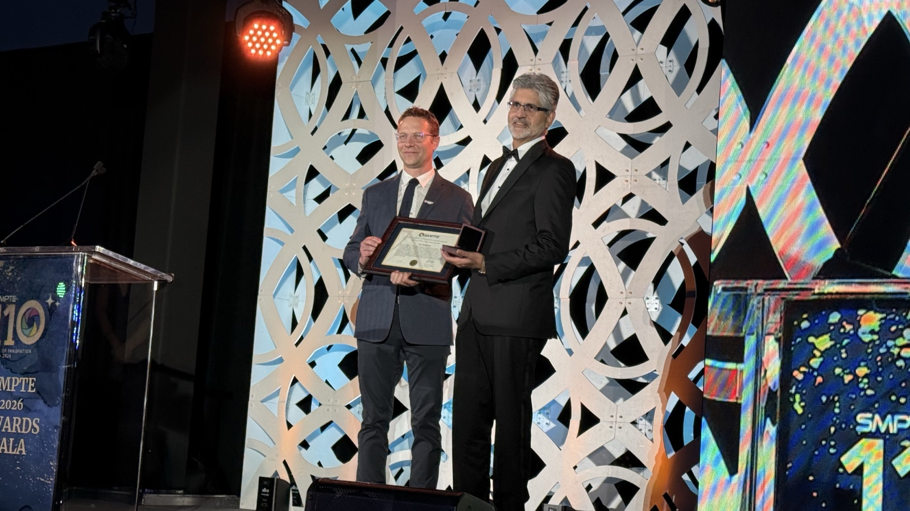

Sigmedia is delighted to announce that **Prof. Anil Kokaram** has been awarded
the **2026 Excellence in Education Medal** by the Society of Motion Picture and
Television Engineers (SMPTE). The medal was presented on November 19, 2026, at
the annual SMPTE Awards Gala during the Media Technology Summit in Pasadena.

Established to recognise outstanding contributions to educational programs in
motion pictures, television, and imaging sciences, this honour is a wonderful
testament to the care, energy, and innovation that Anil and the wider group
bring to engineering education and dissemination. Sigemdia has always been
connecting cutting-edge research directly to our students with industry-deployed
tools and grounding theoretical signal processing and AI in real-world media
challenges.

In its official citation, SMPTE recognised Anil's leadership as Head and Chair
of Electronic and Electrical Engineering at Trinity College Dublin, including
establishing the M.Sc. in Electronic Information and Computational Engineering,
mentoring the IEEE TCD Student Branch, and founding the Sigmedia Research Group
to advance digital visual and audio media.

### Relevant Links
* [SMPTE Excellence in Education Medal Recipients](https://www.smpte.org/about/awards-programs/education-winners)
* [SMPTE 2026 Awards Gala](https://summit.smpte.org/2026/Gala)
* [SMPTE Announces 2026
  Honorees](https://www.smpte.org/blog/smpte-announces-2026-honorees)
* [TCD's M.Sc. in Electronic Information Engineering](https://www.tcd.ie/eleceng/teaching/postgraduate/electronic-information-engineering/)
* [TCD's M.Sc. in Computational Engineering](https://www.tcd.ie/eleceng/teaching/postgraduate/computational-engineering/)
  
  
